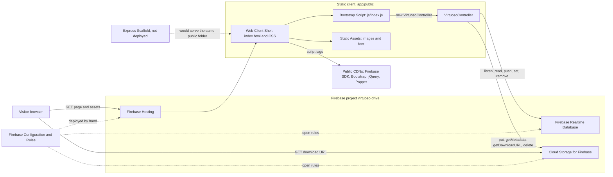
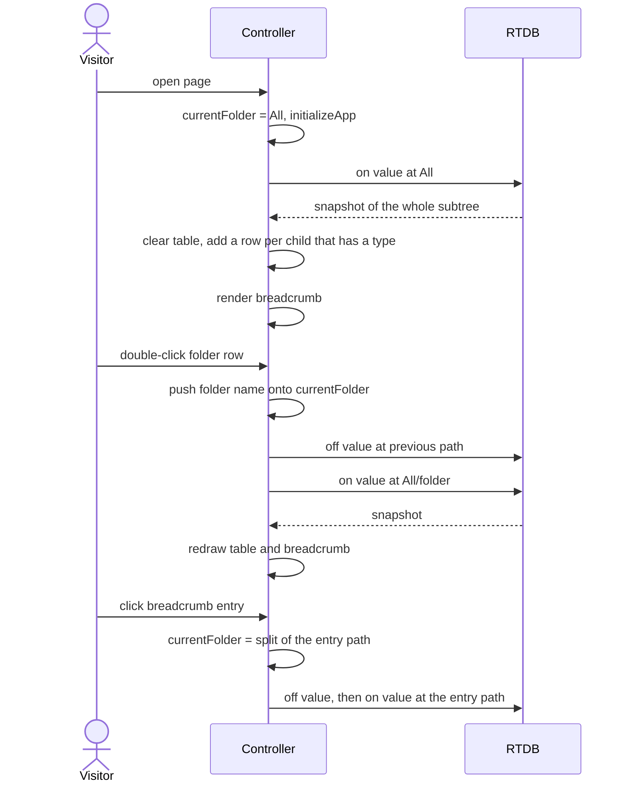
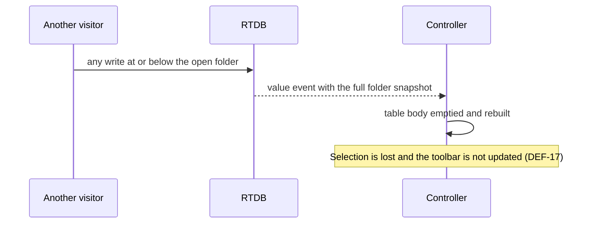
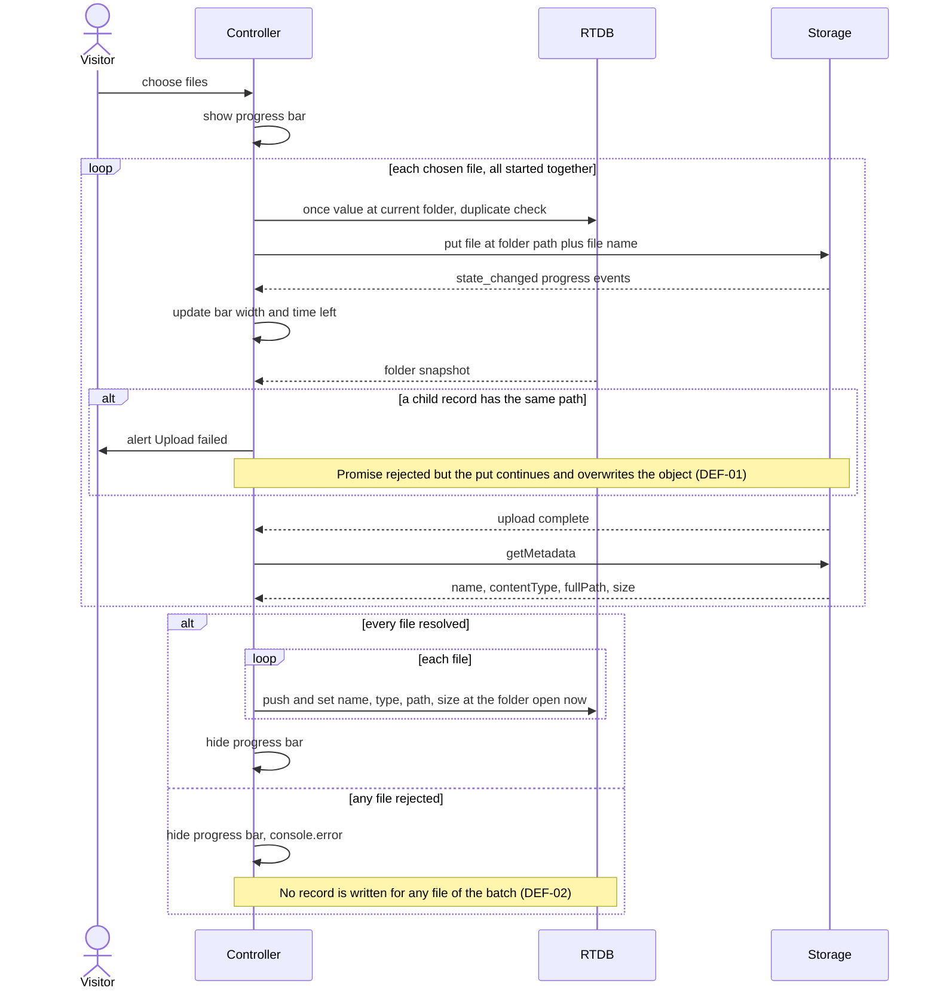
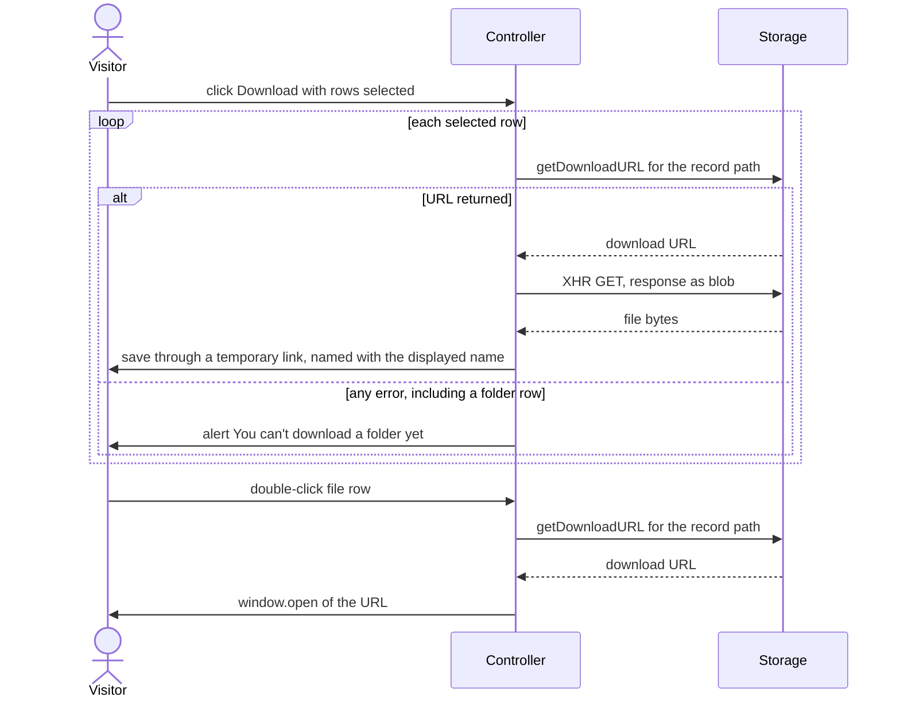
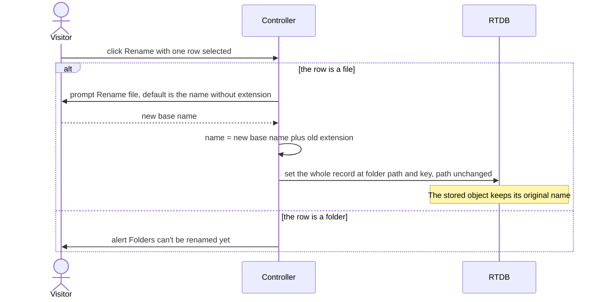
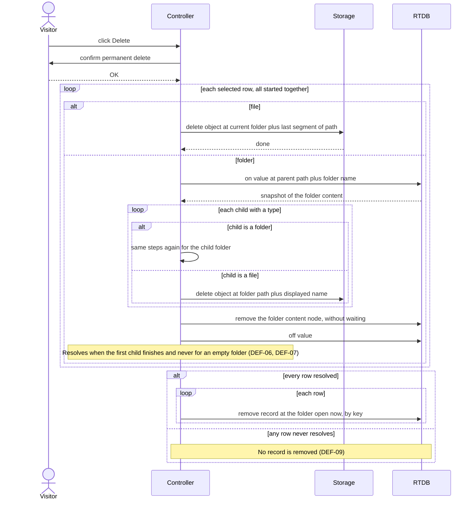
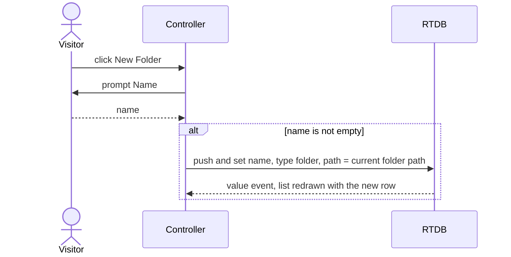
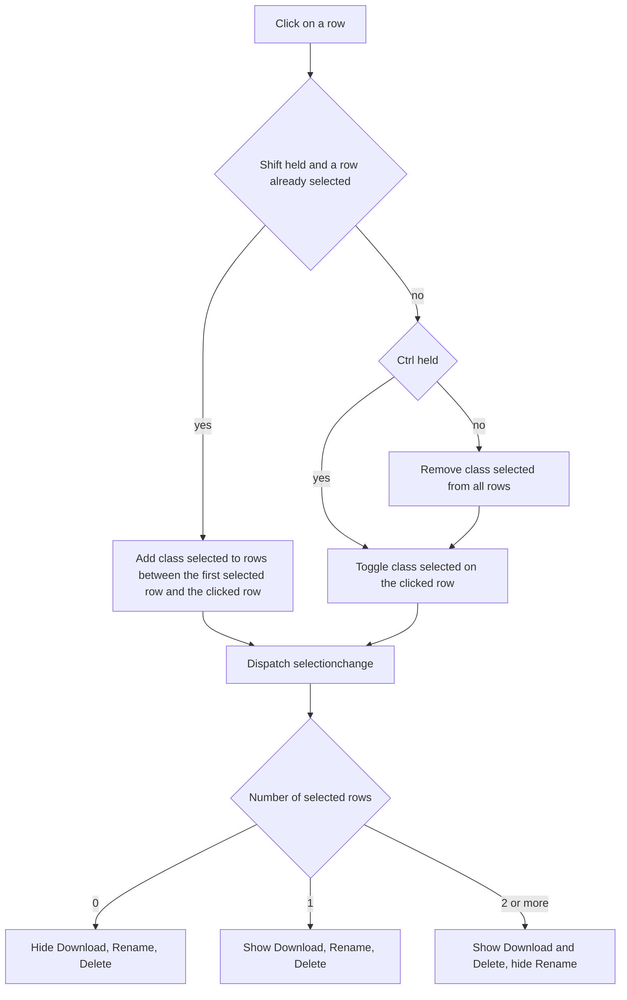

# Architecture: Virtuoso Drive

Source: code at commit `533329e`. Line numbers refer to `app/public/js/VirtuosoController.js` unless another file is named. Statements marked **(inference)** were reasoned from the code or from documented platform behaviour and not observed running. Defect ids (`DEF-`, `SEC-`, `TD-`) are defined in `code-quality-assessment.md`.

## Architecture Analysis

### System Overview

Virtuoso Drive is a static single-page application. Firebase Hosting delivers one HTML page, two stylesheets, two scripts and some images. In the browser, one class (`VirtuosoController`) draws the screen and calls two Firebase services directly: Realtime Database for the folder tree and file metadata, and Cloud Storage for file contents. There is no server-side application code in production. The repository also contains an Express scaffold that is never deployed.

### Architectural Style

Two-tier, client plus backend-as-a-service. Evidence:

- `app/firebase.json` line 6 publishes only `app/public`, with no functions and no server rewrite target other than `/index.html` (lines 12-17).
- Every data and file operation is a Firebase SDK call made from the browser (`getFirebaseRef`, lines 637-643; `firebase.storage()`, lines 34, 162, 491, 549).
- All rules, validation and consistency between metadata and file contents are the browser's responsibility. The platform enforces nothing: both rule files allow everything.

Inside the client there are no layers. One class holds the view, the selection state, the navigation state, the data access and the file transfer.

### Component Relationships

<!-- Text fallback: The visitor's browser loads the page and assets from Firebase Hosting. The page shell (index.html and CSS) pulls the Firebase SDK, Bootstrap, jQuery and Popper from public CDNs, loads the static images and font, and runs the bootstrap script js/index.js, which creates one VirtuosoController. The controller talks directly to Firebase Realtime Database (listen, read, push, set, remove) and to Cloud Storage for Firebase (put, getMetadata, getDownloadURL, delete); the browser also fetches file bytes from Cloud Storage through download URLs. The Firebase configuration and rules files are deployed by hand and give Hosting its settings and both data services open rules. The Express scaffold is not deployed; it would only serve the same public folder. -->

### Data Flow

- **Metadata** lives only in Realtime Database, as a tree under `All` keyed by folder display names. The record shapes are in `api-documentation.md`.
- **File contents** live only in Cloud Storage, at `<folder path>/<original file name>`.
- **The link** between the two is the `path` field of a file record. Nothing keeps the two stores consistent except the order of calls in the browser: upload writes storage first and the record second; delete removes storage first and the record second. A failure or a closed tab between the two steps leaves an orphan object or an orphan record.
- **Client state** is three fields: `currentFolder` (array of names, line 5), `lastFolder` (path of the attached listener, line 674) and `startUploadTime` (line 553). The selection is not held in a variable; it is the set of table rows with the CSS class `selected` (lines 26-30). Each row carries its record as JSON in `data-file` and its push key in `data-key` (lines 139-140).
- **Refresh** is push-based: the list is redrawn from scratch each time the database listener fires (lines 676-691). No operation updates the table itself.

### Key Design Decisions

| Decision found in the code | Implication for a redesign |
|---|---|
| The browser calls the data stores directly, with open rules | There is no place to authenticate, authorise, validate or audit. Every such control is new work |
| Folder content is addressed by the chain of folder display names | A folder has no identity apart from its name and position. Renaming or moving a folder would mean rewriting its subtree, which is why folder rename is not implemented (lines 430-435). Names restricted by the database's key rules break navigation (DEF-10). Duplicate names collide (DEF-11) |
| Records and child-folder content share one node | Entries under push keys and content nodes under folder names are siblings, told apart only by the presence of `type` (line 685). See DEF-12 and DEF-20 |
| Storage key equals folder path plus original file name | The storage key is fixed at upload. Rename changes metadata only (line 426), so name and key drift apart. A second upload of the same name lands on the same key (DEF-01) |
| List refresh by a `value` listener on the folder node | Simple and live, but each event carries the whole subtree below the open folder (DEF-20) and each redraw discards the selection (DEF-17) |
| Multi-step operations coordinated by promises in the browser | Upload and delete are not atomic and have several broken paths (DEF-01 to DEF-09) |
| Native `prompt`, `confirm` and `alert` for all dialogs | No form validation; behaviour is trivial to describe and to re-create |
| No build step; third-party code from CDNs | Nothing to compile today; no pinning beyond the version in the URL (TD-07) |

### Improvement Opportunities

These are observations from the existing code, not design decisions for the new system.

- Put an authorising service between the browser and the stores; close both rule files.
- Give folders and files generated identifiers and store names as plain attributes, with uniqueness enforced by the data store.
- Keep the storage key independent of the displayed name, and record size, content type and a checksum with it.
- Make upload and delete safe against partial failure (order of steps, clean-up of orphans).
- Render names as text, never as markup.
- Decide deliberately what replaces the live listener (see Live refresh below).
- Separate rendering, state and data access so each can be tested.

## Interaction Diagrams

Participants used below: **Visitor**, **Controller** (`VirtuosoController` in the browser), **RTDB** (Firebase Realtime Database), **Storage** (Cloud Storage for Firebase). The diagrams show the code as written, including the paths that are defects.

### Page load and browse

<!-- Text fallback: On page load the controller sets the current folder to All, initialises Firebase and attaches a value listener at All. The database answers with the whole subtree; the controller empties the table and adds one row for every child that has a type field, then draws the breadcrumb. Double-clicking a folder row appends its name to the current folder, detaches the previous listener, attaches a new one at the deeper path and redraws. Clicking a breadcrumb entry sets the current folder from that entry's path and re-attaches the listener there. Evidence: constructor lines 3-24, openFolder 645-653, readFiles 672-693, renderNav 695-740, row double-click 150-174. -->

### Live refresh

<!-- Text fallback: When any visitor writes at or below the folder that is open in someone's browser, the database sends that browser a value event carrying the folder's full snapshot. The controller empties and rebuilds the table. The selection is lost and the toolbar is not updated. The visitor's own uploads, renames, deletions and new folders reach the screen by this same route; no operation edits the table directly. Evidence: lines 676-691. -->

### Upload

<!-- Text fallback: The visitor chooses files; the progress bar appears. For every file at the same time, the controller asks the database for the current folder (duplicate check) and, without waiting for the answer, starts the upload to storage at folder path plus file name. Progress events update the bar and the time estimate. If the duplicate check finds a record with the same path, the visitor gets an "Upload failed" alert and the file's promise is rejected, but the upload carries on and overwrites the stored object. When an upload completes the controller reads the object's metadata. If every file succeeded, one record per file (name, type, path, size) is pushed into the folder that is open at that moment, and the bar is hidden. If any file was rejected, the bar is hidden, the error goes to the console and no record is written for any file of the batch. Evidence: lines 351-385, 523-587, 589-635. -->

### Download and open

<!-- Text fallback: Download: for each selected row the controller asks storage for a download URL for the record's path. On success it fetches the bytes with an XHR as a blob and saves them through a temporary link whose download name is the displayed name. On any error, including when the row is a folder (its path is not an object), it shows "You can't download a folder yet. Choose only files." Open: double-clicking a file row asks for the download URL and opens it in a new window; an error goes to the console only. Evidence: lines 484-521 and 160-170. -->

### Rename

<!-- Text fallback: With exactly one row selected, Rename on a file prompts for a new base name (default: the current name without its extension), appends the old extension and writes the whole record back to the database at the same key with only the name changed. The path field and the stored object are untouched. Nothing happens if the prompt is cancelled or empty. Rename on a folder only shows "Folders can't be renamed yet. Sorry!". Evidence: lines 412-437. -->

### Delete

<!-- Text fallback: After one confirmation, all selected rows are processed together. For a file, the stored object at current folder plus the last segment of the record's path is deleted. For a folder, the controller reads the folder's content node; for each child record it either repeats the same steps (child folder) or deletes the stored object addressed by folder path plus the child's displayed name (child file); straight after starting those, without waiting, it removes the folder's content node from the database and detaches the listener. A folder's step counts as finished when its first child finishes, and never finishes when the folder is empty. Only when every selected row has finished does the controller remove each row's record, by key, from the folder open at that moment; if any row never finishes or fails, no record is removed. Evidence: lines 439-464, 302-347, 245-300, 32-38. -->

### Create folder

<!-- Text fallback: New Folder prompts for a name. If the answer is not empty, a record with the name, type "folder" and the current folder path is pushed into the current folder. No content node is created; it comes into being when something is first written inside the folder. The list shows the new row when the listener fires. No check is made on the name. Evidence: lines 466-482. -->

### Selection and toolbar

<!-- Text fallback: A click with Shift held, when some row is already selected, selects every row between the first selected row and the clicked row. Otherwise, unless Ctrl is held, all rows are deselected first, and then the clicked row's selected state is toggled. Either way a selectionchange event is raised on the table body. Its handler counts the selected rows: none hides Download, Rename and Delete; one shows all three; two or more shows Download and Delete and hides Rename. Upload and New Folder are always visible. Evidence: lines 176-228 and 387-410. -->
