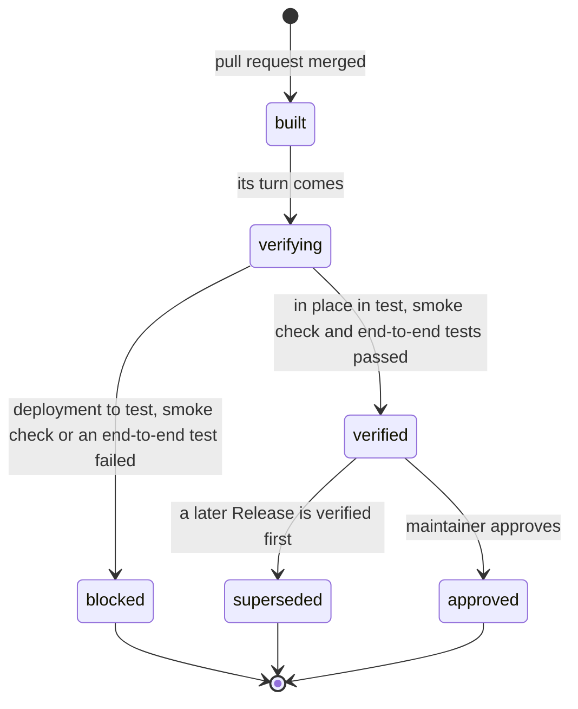
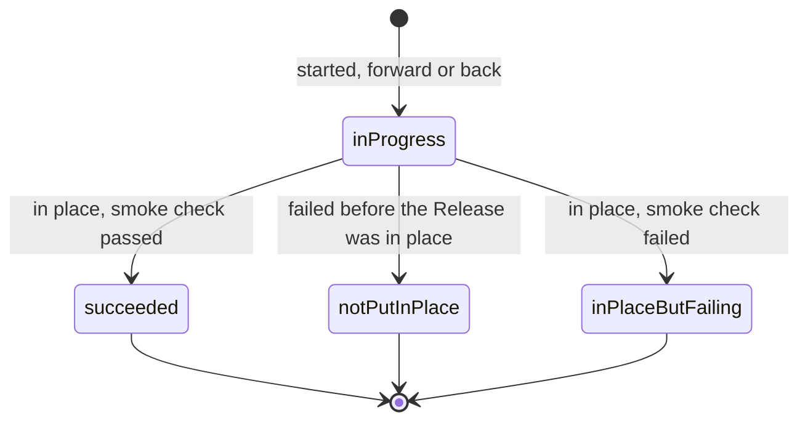
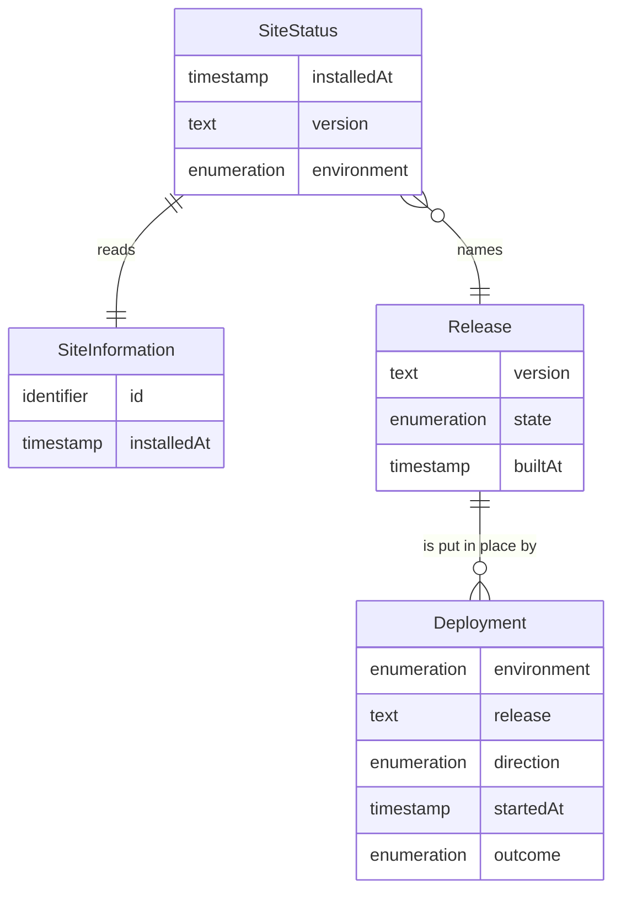

# Functional Specification: U1, the thin slice

What the thin slice does, step by step, without naming any technology. The
slice is the smallest thing that runs the whole way through: one page, one
server call, one database read, and the pipeline and operations around them.
It carries no product feature.

This Unit implements stories **US9.1, US9.2, US9.3 and US9.4**
(`aidlc/spaces/default/intents/261121-aws-migration/inception/user-stories/stories.md`),
which cover requirements FR12.1 to FR12.7
(`aidlc/spaces/default/intents/261121-aws-migration/inception/requirements-analysis/requirements.md`).
It is defined in
`aidlc/spaces/default/intents/261121-aws-migration/inception/units-generation/unit-of-work.md`
(story assignment in `unit-of-work-story-map.md`), touches only the empty
shells of the building blocks in
`aidlc/spaces/default/intents/261121-aws-migration/inception/domain-design/components.md`,
and establishes contract C1 of
`aidlc/spaces/default/intents/261121-aws-migration/inception/contract-design/contract-summary.md`.

The data shapes are in `entities.md` and the rules (BR1.1 to BR7.2) in
`rules.md`; both are the source of truth for what they hold. This document is
the source of truth for the order things happen in and for the states a
Release and a Deployment pass through. The maintainer's answers Q1 to Q4 are
in `functional-design-questions.md`.

Which services, which Region, which pipeline product and the repository's
layout are not decided here; they belong to this Unit's next three steps.

## Operations

| Operation | Path (under `/v1`) | Who may call | Answers |
|-----------|--------------------|--------------|---------|
| Health check | `GET /health` | Anyone, always | `{ status: "ok" }`, or a Problem with status 503 |
| Site information | `GET /site-information` | While an environment is private (BR2.1): anyone holding its access password. In production after the switch (BR2.5): anyone | `{ installedAt, version, environment }`, or a Problem |

`/health` is contract C1's. `/site-information` is new in this Unit and
follows C1's conventions; it is the "one trivial route" C1 refers to. It
exists to prove the connection and has no use in the finished product; a later
Unit may remove it. It reveals nothing that needs protecting once production
is open.

## One departure from the requirements, stated

FR12.2 and AC9.2.2 have the pipeline build everything from an account that
holds **nothing but the budget alarm**. The pipeline cannot create its own
means of signing in to the account, so here the starting point is the budget
alarm **plus that one thing**, both made by a one-time setup kept in the
repository (W4, BR4.1, BR4.2). The delivery plan put this to the maintainer in
Bolt 1's "Done when" list, and it was approved there. AC9.2.2 is met in that
amended form.

## Workflows

### W1. Opening the page

1. A visitor opens the site's address.
2. If the environment is private and the device has not given its access password in the last 30 days, the password is asked for (BR2.1, BR2.3). A wrong password is refused with status 401; ten wrong ones in 5 minutes from one network address are refused for 5 minutes with status 429 (BR2.4). These refusals happen before the request reaches the page or the server; they are not Problems, and each is recorded (BR5.1).
3. The page appears with the site's name and logo and a line saying it is checking.
4. The page asks the server for site information, sending a request identifier.
5. The server reads the SiteInformation record (BR1.1), writes a log entry (BR5.1) and answers.
6. The page replaces the checking line with: the server and database answered; the version; the environment (BR1.2).

Unhappy paths:

- **5a. The database does not answer within 3 seconds, or the record is missing.** The server answers with a Problem, code `serverError`, status 500 (BR1.1, BR1.5), and logs the internal reason.
- **6a. The call fails or does not answer within 10 seconds.** The page tries twice more, with a growing pause. If all three fail it shows that the server could not be reached, with a "Try again" control. It never shows a success from an earlier visit (BR1.2).
- **6b. The answer is a Problem.** The page shows the same could-not-reach view; the Problem's text is not shown to the visitor.

### W2. A health check

1. Monitoring outside the system asks for the health check every minute, without the access password (BR2.1).
2. The server makes a trivial read of the database.
3. If it answers within 3 seconds, the server answers ok; otherwise a Problem with status 503 (BR1.3).
4. Two failures in a row from production send one email to the maintainer, and no more until health returns (BR5.3).

### W3. From a change to production

Checking and merging:

1. The maintainer, or an agent on their behalf, opens a pull request to the integration branch.
2. The checks run: lint, type check, unit and integration tests with coverage, the check of the infrastructure definitions, the audit of dependencies, and, when the change touches the structure of the database, the previous Release's tests against the new structure (BR3.1, BR3.2, BR6.3, BR7.1).
3. If any fails, the pull request cannot be merged. The author fixes it and the checks run again.
4. When all pass, the maintainer merges it on GitHub. No other way into the branch exists (BR3.3).

Verifying, one Release at a time in the order merged (BR3.4):

5. The pipeline builds one Release from the merged change (Release `built`).
6. The Release becomes `verifying`. The pipeline starts a Deployment to the test environment: it applies any change to the database structure, puts the Release in place, and runs the smoke check (BR3.7).
7. The end-to-end tests run against the test environment, holding its access password (BR2.2).
8. If they pass, the Release is `verified`. Any earlier Release still `verified` and not approved becomes `superseded` (BR3.6). The pipeline is now free to verify the next merged change; it does not wait for the maintainer.

Going to production, one Deployment at a time (BR3.6):

9. The maintainer approves the newest `verified` Release. It becomes `approved`.
10. The pipeline starts a Deployment to production: it applies any change to the database structure, puts the same Release in place, unchanged, and runs the smoke check (BR3.7).
11. If the smoke check passes, the Deployment has `succeeded`: that Release is the one running in production, and the one that ran before it is production's previous Release.

Unhappy paths:

- **6a. The Deployment to test fails before the Release is in place** (the database change or the placing itself fails). The Deployment's outcome is `notPutInPlace`; the test environment runs what it ran before; the Release is `blocked`.
- **6b. The Release is in place in test and its smoke check fails.** The Deployment's outcome is `inPlaceButFailing`; the Release is `blocked`. The test environment stays that way until the next Release is deployed or the maintainer goes back (W5).
- **7a. An end-to-end test fails.** The Release is `blocked`; production cannot be given it (BR3.5). The fix is a new pull request, which produces a new Release.
- **9a. The maintainer does not approve.** The Release stays `verified`; production is unchanged. When a later Release is verified, this one becomes `superseded` and can no longer be approved.
- **10a. The Deployment to production fails before the Release is in place.** Outcome `notPutInPlace`; production runs what it ran before; the maintainer is told. The Release stays `approved` and the maintainer may ask for the Deployment to be tried again.
- **10b. The Release is in place in production and its smoke check fails.** Outcome `inPlaceButFailing`: that Release is the one running in production, failing, and the one before it is production's previous Release. The maintainer is told. Whether to go back (W5) is the maintainer's decision; nothing is put back automatically.
- **A Release is approved while a production Deployment is in progress.** It waits its turn; there is never more than one Deployment in progress in an environment.

### W4. Setting up an account for the first time

1. The maintainer runs the one-time setup, giving the address alarm emails should go to.
2. The setup creates the budget alarm, with emails at 80% and 100% of US$50 a month (BR4.1, BR4.3).
3. Only if step 2 succeeded, the setup creates what lets the pipeline sign in to the account without long-lived keys (BR4.2).
4. The maintainer confirms the email subscription from the message they receive.
5. From here everything is created by the pipeline (BR4.2): the first merged pull request builds both environments.

Unhappy paths:

- **2a. The alarm cannot be created.** The setup stops, says why, and creates nothing at all (BR4.1).
- **The setup is run again.** It changes nothing that already exists.

### W5. Going back to the previous version

Works the same way in the test environment and in production.

1. The maintainer asks the pipeline for the previous version in one environment.
2. The pipeline starts a Deployment there with direction `back`, of that environment's previous Release, unchanged. It does not rebuild it and does not touch the database (BR6.1, BR6.3).
3. The smoke check runs against that environment.
4. If it passes, the Deployment has `succeeded`: the earlier Release is the one running there, and the one it replaced is now that environment's previous Release (so asking to go back a second time returns to it).
5. The first time this is done in the test environment, a record of it is added to the repository through a pull request (BR6.2).

Going back changes no Release's state: a Release's state says how far it came
towards production, and where it runs is told by Deployments.

Unhappy paths:

- **2a. The Deployment fails before the Release is in place.** Outcome `notPutInPlace`; the environment runs what it ran; the maintainer is told.
- **3a. The smoke check fails.** Outcome `inPlaceButFailing`; the maintainer is told; the environment is left as it is.
- **There is no previous Release** (only one Release has ever been put in place there). The pipeline says so and does nothing.

### W6. Being told about failures

1. Every request writes one log entry (BR5.1), with no email address or secret in it (BR5.4). Requests refused for want of the access password are recorded too, as "access refused".
2. At the end of each 5 minutes, if more than 5% of the requests production's server received, health checks excluded, were server failures, one email is sent to the maintainer (BR5.2). Access refusals never reach the server and are not counted.
3. The maintainer searches the logs by request identifier or by time to find what happened.

## States of a Release

A Release's state says how far it has come towards being allowed into
production. It does not say where the Release is running.

| From | Event | To |
|------|-------|-----|
| (none) | Pull request merged | built |
| built | Its turn comes | verifying |
| verifying | In place in test; smoke check and end-to-end tests passed | verified |
| verifying | Deployment to test, smoke check or an end-to-end test failed | blocked |
| verified | Maintainer approves | approved |
| verified | A later Release is verified first | superseded |

`blocked`, `superseded` and `approved` are final. An `approved` Release may be
deployed to production more than once (a retry after 10a, or by going back).

## Outcomes of a Deployment

| From | Event | To |
|------|-------|-----|
| (none) | Started, forward or back | inProgress |
| inProgress | Release in place and smoke check passed | succeeded |
| inProgress | Database change or placing failed | notPutInPlace |
| inProgress | Release in place and smoke check failed | inPlaceButFailing |

In each environment:

- **The running Release** is the Release of the latest Deployment whose outcome is `succeeded` or `inPlaceButFailing`. There is always exactly one, once the first Deployment has put a Release in place.
- **The previous Release** is the one that was running immediately before it.
- At most one Deployment is `inProgress`.

## Entities (derived from `entities.md`)

Text form: a SiteStatus answer reads the one SiteInformation record and names
the running Release. A Release is put in place by any number of Deployments,
each in one environment. HealthReport, Problem and RequestLogEntry stand
alone.

## Rules (derived from `rules.md`)

| Group | Rules | About |
|-------|-------|-------|
| BR1 | BR1.1 to BR1.5 | The page, its call, the health check, request identifiers, failures |
| BR2 | BR2.1 to BR2.5 | Keeping both environments private with an access password |
| BR3 | BR3.1 to BR3.7 | From pull request to production |
| BR4 | BR4.1 to BR4.4 | Budget alarm first; everything from the repository |
| BR5 | BR5.1 to BR5.4 | Logs and emails about failures |
| BR6 | BR6.1 to BR6.3 | Going back to the previous version |
| BR7 | BR7.1 to BR7.2 | Housekeeping and the examples left for later Units |

## Edge cases settled here

| Case | What happens | Rule |
|------|--------------|------|
| Database unreachable | Site information fails with a Problem, status 500; health answers 503; the page shows could-not-reach | BR1.1, BR1.3, BR1.2 |
| Database slow | Treated as unreachable after 3 seconds | BR1.1, BR1.3 |
| SiteInformation record missing | Treated as a server failure; it means the first change to the database structure was not applied | BR1.1 |
| Caller sends a malformed request identifier | Replaced with a generated one; not rejected, not logged as sent | BR1.4 |
| Unknown address | Problem, `notFound` | BR1.5 |
| No access password, or a wrong one | Refused with 401 before the server; not a Problem; recorded | BR2.1, BR5.1 |
| No traffic in a 5-minute period | No email; nothing to measure | BR5.2 |
| Health keeps failing | One email, then silence until health returns | BR5.3 |
| A later Release is verified while an earlier one waits for approval | The earlier one is superseded and can no longer be approved | BR3.6 |
| A production Deployment fails before anything changed | Production runs what it ran; the Release stays approved and can be tried again | BR3.7 |
| The page is opened with JavaScript unavailable | The page shows its name and a line saying the site needs JavaScript | BR1.2 |

## Open points for this Unit's next steps

These are stated so they are not lost; none blocks this document.

1. **How the access password is asked for and remembered.** The maintainer chose a password "asked for by the browser". The browser's own password prompt and the signed-in session that contract C1 defines for later Units would use the same place in a request, so they would collide from Bolt 5 on. BR2.3 forbids the collision. Whether that is met by a different way of remembering, or by a small password page in place of the browser's prompt, is for this Unit's infrastructure design. If it must be a page, the maintainer will see a page where they expected a browser prompt, and that needs their agreement then.
2. **The error-rate email at very low traffic.** With a handful of requests in 5 minutes, one failure exceeds 5%. The rule follows the requirement as written; whether a minimum number of requests should apply is for the quality-requirements step, and would change FR12.6.
3. **Whether a budget alarm can be created by script in a new account** with no console step is not verified (carried from the delivery plan). If it cannot, BR4.1's first act needs one stated exception accepted by the maintainer.
4. **Where the Release and Deployment records live** depends on the pipeline product.
5. **Coverage as one figure** (Q4) lets a well-covered codebase absorb one poorly covered change. Accepted by the maintainer's choice; noted so that it is a known property.
6. **AC9.1.2 says "the lines of the new code"**; the maintainer's answer Q4 reads that as all new code in the repository, not the lines of each pull request.
7. **A database change is applied before the Release is in place.** If a production Deployment ends `inPlaceButFailing` after such a change, going back relies entirely on BR6.3 having held.
