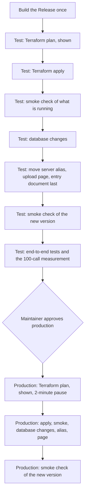

# Pipeline Design: U1, the thin slice

How a change travels from a pull request to production, how it is put back,
and what the pipeline may touch. It implements workflows W3 to W5 of
`aidlc/spaces/default/intents/261121-aws-migration/construction/u1-thin-slice/functional-design/functional-spec.md`
with the mechanisms of
`aidlc/spaces/default/intents/261121-aws-migration/construction/u1-thin-slice/nfr-design/reliability-design.md`
(R2 to R5) and `security-design.md` (S3, S8) beside it, on the parts in
`logical-components.md` and the resources in `infrastructure-specification.md`.
`performance-design.md`, `scalability-design.md` and `observability-design.md`
supply the checks it runs; contract C1
(`aidlc/spaces/default/intents/261121-aws-migration/inception/contract-design/contract-summary.md`)
and the building blocks
(`aidlc/spaces/default/intents/261121-aws-migration/inception/domain-design/components.md`)
supply what it tests.

The pipeline is GitHub Actions (technology decisions T7). Workflow files are
written at the code step; this document fixes what they do.

## Vocabulary

- **Release**: one build of one merged commit, named by the commit's short identifier. Built once, deployed unchanged to both environments.
- **Deployment**: one attempt to put a Release in place in one environment, recorded with GitHub's deployments feature, which is the pipeline's record of what runs where.

## Workflows

| Workflow | Starts when | AWS identity | Purpose |
|----------|-------------|--------------|---------|
| `checks` | A pull request to `aws-migration` is opened or updated | None | Everything that must pass before merging |
| `deliver` | A commit lands on `aws-migration` | Test, then production after approval | Build the Release; deploy to test; verify; deploy to production |
| `go-back` | The maintainer starts it by hand, naming an environment | That environment's | Put the previous Release back |
| `compare` | Weekly for test; for production, when the maintainer starts it by hand and approves | That environment's | Report anything in AWS that differs from the repository |

GitHub runs scheduled and manually started workflows only from the
repository's default branch. The roles trust only the branch `aws-migration`
(test) and the `production` environment restricted to that branch. So
`aws-migration` is made the default branch (`infrastructure-specification.md`,
GitHub settings); without that, `go-back` and `compare` could not obtain an
identity. This needs the maintainer's agreement at the code plan.

`compare` runs Terraform's plan and reports what it would change. There is no
separate read-only identity: it runs with the environment's ordinary identity
and applies nothing. For production it therefore needs the same approval as a
deployment, which is why it is not scheduled there; every production
deployment shows the same plan in any case.

`checks` is given no permission to request an AWS token, and the roles' trust
would refuse it one (security design S3). Runs of `deliver` are queued one
at a time; a newer commit waits for the test stage of the one before it.

## `checks`: the pull request

| Step | Tool | Fails the pull request when |
|------|------|------------------------------|
| Install | The package manager, from the lockfile | The lockfile is missing or would change |
| Format and lint | Prettier, ESLint | Any difference or error, including the rules against building SQL from text and against React's unescaped HTML |
| Type check | TypeScript, `strict` | Any error |
| Unit and integration tests with coverage | Vitest; PostgreSQL in a container | A test fails, or line coverage of new TypeScript is under 80% |
| Compatibility | The integration and end-to-end tests of every version in reach, against this pull request's database changes and server (reliability design R5) | Any fails |
| Build | The page, the server package, the change runner package, the access gate | A build fails, or the page's first load is over 300 KB compressed |
| Terraform | `fmt -check`, `validate` with no backend | Either fails |
| Infrastructure scan | Checkov on the Terraform files | A finding without a recorded, reasoned exception |
| Dependencies | The package manager's audit | A vulnerability rated high or above |
| Secrets and personal data | A secret scanner; a search for email-shaped text outside an allow-list | Anything found |
| Forbidden things | Searches for Firebase and Google libraries, for new plain JavaScript source files, for a committed dependency folder | Anything found |
| Pinning | Actions referenced by commit; exact Terraform and provider versions | A movable reference |
| Description | The pull request names its Unit | It does not |

The first eleven are what the single local command runs too
(technology decisions, NFR12.4); the last two are GitHub-side.

Merging is by squash, by the maintainer, on GitHub, only when every step has
passed and the branch is up to date (branch protection).

## `deliver`: after the merge

Text form, with what each stage needs to pass:

| # | Stage | Identity | Passes when | If it fails |
|---|-------|----------|-------------|-------------|
| 1 | Build | None | The page, both packages and the gate are built from the merged commit and stored as the run's artifacts | The run stops; nothing changed |
| 2 | Test: plan and apply | Test | Terraform's plan is printed, then exactly that plan is applied; the packages are uploaded to `releases` | Deployment: not put in place |
| 3 | Test: smoke check of the running version | Test | Health is ok and site information answers. Skipped when GitHub's record shows no earlier succeeded Deployment in this environment: on a first deployment only the placeholder is running, and it answers 503 by design | Not put in place: the infrastructure change broke the running version; the maintainer is told |
| 4 | Test: database changes | Test | The pipeline updates `db-migrate`'s code to this Release's package, starts it, and it reports success. In a new environment the same run first creates the database users (`infrastructure-specification.md`) | Not put in place |
| 5 | Test: switch | Test | A new version of `server` is published and the alias `live` moved to it; the Release's page folder is uploaded; the entry document is replaced last | The alias and entry document are moved back; not put in place |
| 6 | Test: smoke check of the new version | Test | Health ok; site information shows this Release's version; the page loads | In place but failing; the Release is blocked |
| 7 | Test: verify | Test | Playwright's end-to-end tests pass in three browser engines, with the accessibility scan and the check that no outside address is contacted; 100 site-information calls have a 95th of 100 at or under 1 second | The Release is blocked; production cannot receive it |
| 8 | Approval | - | The maintainer approves the `production` environment's job. Only the newest verified Release can be approved; an older waiting run is cancelled when a newer one is verified | Production unchanged |
| 9 | Production: stages 2 to 6 again | Production | As above, with a 2-minute pause between showing the plan and applying it | As above; a failure also publishes to `vd-alarms` |

After stage 9 the Deployment is recorded as succeeded and the Release is the
one running in production.

**Order within a deployment** is always: infrastructure, database, server,
page (reliability design R3). New code never meets an old database structure.

**Starting the change runner.** The pipeline calls `db-migrate` directly and
waits for its answer, with the caller's own time limit set above the
function's 5 minutes and the caller's automatic retries switched off, so that
a slow run is neither abandoned nor started twice. Its code is first updated
to the Release's package, and the call names that exact published version. If
a call is repeated anyway, it is harmless: files already applied are recorded
and skipped, and a lock in the database stops two runs overlapping.

**The first deployment to an environment**, walked through: stage 2 creates
everything, with a placeholder as the server's code; stage 3 is skipped;
stage 4 creates the database users and applies the first change (the site
information record); stage 5 publishes the first real version of the server
and moves the alias from the placeholder to it, then uploads the page; stage
6 is the first smoke check that must pass. A failure anywhere leaves the
placeholder answering 503, which is the honest state of an environment with
nothing deployed.

**Telling the maintainer of a failure.** The production job's last step
publishes to `vd-alarms` when the job fails after obtaining its identity.
Failures in test, and failures before an identity is obtained, are reported
by GitHub's own email about the failed run.

**The pipeline's tests get in** by reading the access password from Parameter
Store with the environment's identity and setting the `vd_access` cookie.

## `go-back`

| # | Step | Passes when |
|---|------|-------------|
| 1 | The maintainer starts the workflow for `test` or `production`. For production the same approval applies | - |
| 2 | Find the previous Release from GitHub's record of deployments for that environment | One exists; otherwise the workflow says there is none and stops |
| 3 | Move the alias `live` to that Release's numbered version; put that Release's entry document back | Both done |
| 4 | Smoke check, expecting the previous Release's version | Passes: recorded as a succeeded Deployment, direction back. Fails: in place but failing; the maintainer is told |

Nothing is rebuilt. Terraform and the database are not touched. Because the
previous Release is kept among the ten most recent, this needs no build and
takes a few minutes.

## Promotion and strategy

| Question | Answer |
|----------|--------|
| How does a change reach production? | The same Release that passed in test, after the maintainer's approval. Nothing is rebuilt for production |
| Strategy | All at once, by moving one alias and one entry document. No gradual shift of traffic: with one maintainer and tens of users, the smoke check and a fast way back serve better than a canary |
| Environment-specific settings | Terraform variables files, one per environment, in the repository; they hold no secrets |
| Feature switches | None, except the access gate's on/off flag and the alarm-proof switches, all Terraform variables |

## Secrets in the pipeline

| What | Where it lives | How the pipeline uses it |
|------|----------------|--------------------------|
| AWS credentials | Nowhere. One-hour credentials are issued per job through OpenID Connect | Requested by the job; never stored |
| The two role identifiers | GitHub repository variables (not secret) | To ask for the identity |
| Access password | Parameter Store, per environment | Read by the test and smoke steps; masked in output |
| Origin secret, database master password | Secrets Manager, made by Terraform | The pipeline's steps do not read them; Terraform's state holds both, and is protected as a secret |
| Terraform state | S3, one key per environment | Read and written by that environment's identity only |
| The maintainer's email address | The SNS subscription | Never seen by the pipeline |

GitHub holds no long-lived secret for this project at all.

## What is left behind as examples

The slice's pipeline is also the pattern later Units follow: one operation
with its unit test; one database access with its integration test against a
real PostgreSQL; one end-to-end test; one Terraform module with its Checkov
run; the workflows above.

## Open points

1. **The check that proves each finished Unit** is to be chosen by the maintainer at the first checkpoint. The candidate is the single local command covering the first eleven `checks` steps, followed by the end-to-end tests against the test environment.
2. **Running the tests of every version in reach** on each pull request lengthens `checks`; it is expected to be two or three versions.
3. **GitHub's plan for this repository** must allow branch protection, required reviewers on an environment, and enough Actions minutes. Unverified. If required reviewers are not available, production approval needs another mechanism and the maintainer is asked.
4. **The 2-minute pause** before production's apply is a chance to cancel, not an approval. The maintainer approved before the production plan existed (security design S8).
5. **`compare`** reports differences; it does not correct them.
6. **If GitHub is unavailable**, nothing can be deployed or put back. Accepted in the quality design.
