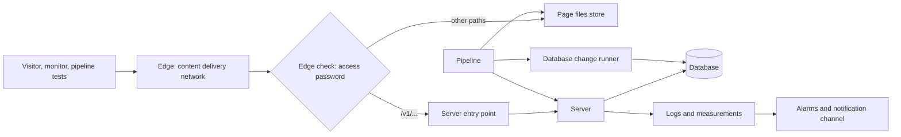

# Logical Components: U1, the thin slice

The parts the running system is made of, what each is for, and what breaks
when one fails. This is the map the infrastructure design (the next step)
turns into AWS resources and prices. The five design documents beside this one
say how each quality requirement is met; this one says where.

Sources: the quality requirements and technology decisions
(`aidlc/spaces/default/intents/261121-aws-migration/construction/u1-thin-slice/nfr-requirements/security-requirements.md`,
`performance-requirements.md`, `scalability-requirements.md`,
`reliability-requirements.md`, `observability-requirements.md`,
`tech-stack-decisions.md`), the slice's design
(`aidlc/spaces/default/intents/261121-aws-migration/construction/u1-thin-slice/functional-design/functional-spec.md`),
contract C1
(`aidlc/spaces/default/intents/261121-aws-migration/inception/contract-design/contract-summary.md`),
and the answers in `nfr-design-questions.md`.

AWS service names below follow the technology decisions already made. Where a
detail of a service's behaviour matters to the design, it is marked "to
confirm" and is checked against current documentation at Infrastructure
Design before anything is built on it.

## One address

The page and the server share one address, as contract C1 states
(`https://virtuoso.andrefellipelabs.com/v1` for the server). Everything enters
through the content delivery network, which sends `/v1/...` to the server's
entry point and everything else to the page's files. Consequences:

- The access password is checked in one place, for both (security design).
- The browser makes no cross-site request, so no cross-origin rules are needed.
- The health monitor and the pipeline's tests use the same address as people do.

Text form: a request reaches the edge; the edge check lets it through or
answers with the password page; paths under `/v1` go to the server's entry
point and on to the server, which reads the database and writes logs; other
paths are served from the page files store. The pipeline replaces the server
and the page's files and starts the database change runner. Alarms read the
logs and measurements and email through the notification channel.

## Per environment (test and production each have their own)

| Component | Service (from the technology decisions) | Responsibility | Holds state? |
|-----------|------------------------------------------|----------------|--------------|
| Edge | Amazon CloudFront | The one public address; TLS; sends requests to the right origin; stores the page's files near visitors | No |
| Edge check | A small function at the edge | Lets a request through if it carries the access password's cookie or is the health check; otherwise answers with the password page | No |
| Page files store | Amazon S3, private | Holds each Release's built page files; readable only by the edge | Files |
| Server entry point | Amazon API Gateway (HTTP API) | Receives `/v1` requests from the edge; applies the request limit; passes them to the server | No |
| Server | AWS Lambda, one function, modules inside | The operations: health, site information | No (one database connection kept per running copy) |
| Database change runner | AWS Lambda, a second function | Applies pending changes to the database's structure when the pipeline starts it | No |
| Release package store | Amazon S3, private | Holds the server's and the change runner's packages for the ten most recent Releases; the function's numbered versions are kept for the same ten | Files |
| Database | PostgreSQL; service chosen at Infrastructure Design | The system of record | Yes |
| Secrets | AWS Secrets Manager | The access password; the secret the edge adds to prove a request came through it; the database's credentials if the chosen service needs any | Yes |
| Logs and measurements | Amazon CloudWatch | Entries, figures, saved searches, the one screen | 30 days |
| Alarms | Amazon CloudWatch alarms | Error rate, health, failed deployment (production only) | No |
| Health monitor | An AWS-managed outside check | Asks `/v1/health` every minute | Figures |
| Private network | A network with no route to the internet | Where the database, the server and the runner sit | No |

## Once per account (made by the one-time setup, never by the pipeline)

| Component | Service | Responsibility |
|-----------|---------|----------------|
| Budget alarm | AWS Budgets | Emails at US$40, US$50, and when the forecast passes US$50 |
| Notification channel | Amazon SNS | Holds the maintainer's address; every alarm sends through it |
| Pipeline identities | AWS IAM with GitHub's OpenID Connect | The test identity and the production identity, each with its own outer limit that it cannot widen |
| State bucket | Amazon S3 | Terraform's state: one for each environment and one for the setup |

## Outside AWS

| Component | Responsibility |
|-----------|----------------|
| GitHub repository and Actions | Source, pull request checks, the pipeline, the record of Releases and Deployments, approval for production |
| Amazon Route 53 zone (already exists) | The name; not created or deleted by this work |

## What depends on what, and what fails with it

| If this fails | Then | Seen by | Contained by |
|---------------|------|---------|--------------|
| Database | Site information and health fail; the page shows could-not-reach | Health alarm; error-rate alarm | The server answers within 3 seconds and recovers by itself when the database returns |
| Server | Same as above | Same | The edge still serves the page's files, so the page can say what is wrong |
| Server entry point | Same as above | Same | - |
| Edge check | Every request is refused or, if it fails open, let through | Health alarm if refused | It is written to refuse when in doubt; nothing behind it is sensitive in this Unit |
| Edge or page files store | The site does not load at all | Health alarm | - |
| Database change runner | The Deployment ends as not put in place; the environment keeps running what it ran | The pipeline; the failed-deployment email | Changes are applied before the new version starts; a failed change stops the Deployment |
| Secrets | A new copy of the server cannot start; running copies continue | Error-rate alarm | Values are read once per copy and kept |
| Logs and measurements | The site works; nothing is recorded and no alarm can fire | Nobody, until someone looks | Accepted: an AWS-wide failure of this kind is rare and out of the maintainer's hands |
| Notification channel or an unconfirmed subscription | Alarms fire and nobody is told | Nobody | The setup reports an unconfirmed subscription; alarms are proved once |
| The pipeline (GitHub) | Nothing can be deployed or put back; the running site is unaffected | The maintainer | Accepted |
| The whole Region | Everything is down | The health monitor, if it runs from elsewhere | Accepted: one Region by decision |

## What the two environments share

- The AWS account, the budget alarm, the notification channel and the state bucket.
- Nothing else. Each environment has its own edge, files, server, database, secrets, network and logs, named with the environment's name, and each pipeline identity can touch only its own (security design).

Because they share an account, a runaway cost in the test environment counts
against the same US$50. The request limit and the cap on running copies are
therefore set lower in test (scalability design).

## Isolation

| Boundary | How it is kept |
|----------|----------------|
| Internet to database | The database has no public address; only the server and the runner, inside the private network, can connect |
| Internet to server | The server's entry point is public by nature. The server refuses any request that does not carry the secret the edge adds, so it cannot be used around the edge check |
| Internet to page files | The store is private; only the edge may read it |
| Test to production | Separate resources and separate pipeline identities |
| Pipeline to account foundations | Each identity's outer limit excludes the budget alarm, the notification channel, the identities and limits themselves, the state bucket's settings, and everything of the other environment |

## Open points for Infrastructure Design

1. **Which PostgreSQL service**, with prices (the maintainer's decision, deferred).
2. **How the server reaches the secrets service from a network with no route to the internet.** A private connection point has a fixed monthly cost in each environment. The alternatives are to give the server its values when it is deployed, or to choose a database sign-in that needs no stored password. The security design states the conditions any choice must meet.
3. **What the edge check can do.** The design assumes a small function at the edge can read a cookie, compute a one-way scramble, answer with a page, and write a log line, at no fixed cost. To confirm.
4. **Which health monitor**, by price.
5. **Whether a new account's limit on simultaneous copies of a function** is below the caps this design sets (the delivery plan's dependency D16).
