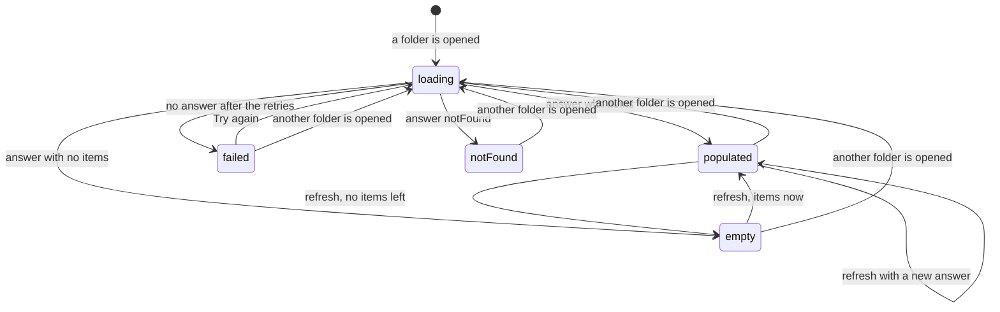
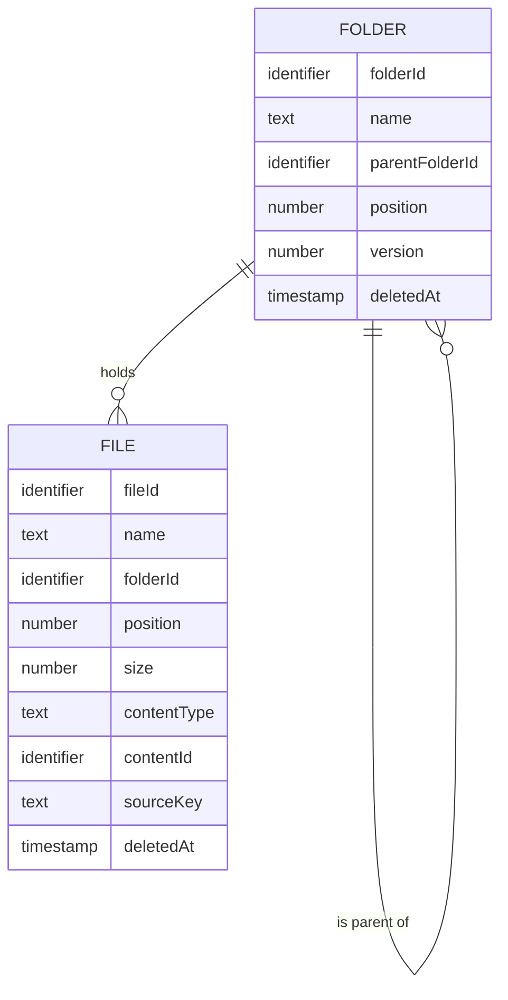

# Functional Specification: U3, browsing and selecting

What browsing does, step by step. This file is the source of truth for the
workflows and the states of the list. The records are defined in
`entities.md` and the rules in `rules.md`, both beside this file; the diagram
and the rules table here are views of those two.

**Stories implemented** (from
`aidlc/spaces/default/intents/261121-aws-migration/inception/user-stories/stories.md`):
US1.1 See what is in a folder; US1.2 Move through folders; US1.3 Know what
the list is doing; US2.1 Select rows.

**Contracts delivered** (from
`aidlc/spaces/default/intents/261121-aws-migration/inception/contract-design/contract-summary.md`):
C3 (the folder route) and the U3 part of C9 (the records, the visibility
rule, the name rules, and the read operations `getFolderView`,
`getVisibleFile`, `checkName` and `lowestFreeName`).

**Building blocks touched** (from
`aidlc/spaces/default/intents/261121-aws-migration/inception/domain-design/components.md`):
Drive, read side; WebClient: list, breadcrumb, selection, action bar.

## What the maintainer decided for this Unit

| Question | Answer | Effect |
|----------|--------|--------|
| Q1 "Changed by" | Left to U6 | No row carries it; U3 does not depend on accounts; the build order stands |
| Q2 Sample files | Without contents until U4 | A file's contents reference may be empty in U3 only |
| Q3 The look | All seven changes accepted | U3 builds changes 1, 3, 4, 6 and 7; 2 and 5 are settled for U7 and U6 |
| Q4 Sample content | Test environment only | Production shows an empty "All" until the migration |

With Q1 and Q2 answered this way, the condition the build order rests on
(`aidlc/spaces/default/intents/261121-aws-migration/inception/delivery-planning/bolt-plan.md`)
is met.

## Scope of this Unit

In: reading a folder; the path; order; visibility; the name rules as
operations other Units call; the list with its views; the breadcrumb;
selection by mouse, keyboard and touch; the action bar following the
selection; the phone layout; sample content in the test environment.

Not in, and where it goes: "changed by" (U6); downloading and opening files
(U4); the periodic re-asking that shows other people's changes, and the
out-of-date note (U5); creating, renaming, deleting, restoring (U6);
uploading (U7); bringing content over (U8); signing in (U2). Nothing in U3
changes a folder or a file through the site.

## Workflows

### W1: The server answers a request for a folder

Rules: BR1.1 to BR1.10.

1. Take the folder identifier from the request. If it is neither `root` nor of the form of a generated identifier, answer `notFound` (BR1.10).
2. If it is `root`, use the top folder (BR1.2).
3. Read the folder and the folders above it, up to the top. If the folder is missing, or it or any folder above it is deleted, answer `notFound` (BR1.4).
4. If the caller sent a version equal to this folder's current version, answer "unchanged" with no content (BR1.8). Stop.
5. Read the folder's items that are not deleted, in order of position (BR1.3, BR1.5).
6. Build the path from the folders read in step 3 (BR1.6) and one row per item (BR1.7).
7. Answer with the folder view and the folder's current version.

Steps 3 to 6 see the folder at one moment: a change that lands between them
never produces an answer that mixes an old list with a new version. If the
database does not answer within 3 seconds, the answer is the Problem
`serverError`, as U1 established; nothing partial is returned.

The version sent to the caller is opaque to it. It is made from the folder's
identifier and its version number, so a version of one folder never matches
another.

### W2: The page opens a folder

Rules: BR3.1 to BR3.10, BR4.9.

1. Work out the folder from the address: none means `root` (BR3.1).
2. Clear the selection and the anchor (BR4.9). Show the breadcrumb with what is known: on first arrival just "All"; when coming from a row or a breadcrumb step, the steps up to the one chosen.
3. Show three placeholder rows (BR3.5) and ask the server for the folder.
4. On an answer with items: show the rows (BR3.2 to BR3.4), the full breadcrumb (BR3.9), set the page's title to the folder's name, announce "Folder (name), (count) items.", and move focus to the list.
5. On an answer with no items: the same, with "This folder is empty." in place of the rows (BR3.6).
6. On `notFound`: show the not-found view (BR3.8).
7. On any other failure, after the two further tries that every read gets: show "The list could not be loaded." with "Try again" (BR3.7). "Try again" returns to step 3.

Opening a folder from a row or from the breadcrumb changes the address and
then runs these steps; so do the browser's back and forward. An answer that
arrives for a folder the visitor has already left is discarded.

### W3: The page refreshes the folder on screen

Rules: BR1.8, BR4.8.

1. Ask the server for the open folder, sending the version held.
2. On "unchanged": do nothing.
3. On a new answer: replace the rows; keep selection, anchor, focus and scroll position by item identifier (BR4.8); announce what changed only if a selected row is gone.
4. On failure: keep what is on screen. (The out-of-date note belongs to U5.)

In U3 a refresh happens when the page becomes visible again after being in
the background. (A reload of the page is not a refresh: it starts again at
W2 with an empty selection.) Asking on a timer is U5's, and uses this same
workflow unchanged. Because nothing can change content through the site until
U6, a refresh in U3 only ever shows changes made by a deployment's sample
content. The workflow is built now, and its selection rule is tested with a
list that changes between two answers. That proves the mechanism behind
AC2.1.6; the criterion as a person meets it, another person's change
arriving, can be shown end to end only when U5 and U6 exist, and both must
repeat the test.

### W4: The visitor selects rows

Rules: BR4.1 to BR4.7, BR4.10.

1. An input arrives on the list: a click, a key, or a tap.
2. Work out the new selection from the table below.
3. Show it (BR4.5), announce the count, and show the actions that fit (BR4.4).
4. If the visitor chooses an action: say "This is not available yet." (BR4.10).

| Input | Selection afterwards | Anchor afterwards |
|-------|----------------------|-------------------|
| Click a row with no key held; tap a row away from its tick box and name | That row only | That row |
| Ctrl-click or Command-click; Space on the focused row; tap a tick box | That row added, or removed if it was selected | That row |
| Shift-click; Shift with arrow up or down; Shift-Space | Every row from the anchor to that row | Unchanged; if there was none, the row that had the focus before the input, or the first row |
| Ctrl-A or Command-A | Every row | Unchanged; if there was none, the focused row, or the first row |
| Escape; the "Clear" control in the status line | Empty | None |
| Arrow up or down alone | Unchanged; only the focus moves | Unchanged |
| Double-click or Enter on a folder; tap a folder's name | Empty, in the folder that opens (W2) | None |
| Double-click or Enter on a file | That row only; the status line says opening is not available yet (BR3.10) | That row |
| Tap a file's name | That row only | That row |
| Tap the name of a file that is already the only selected row | Unchanged; the status line says opening is not available yet | Unchanged |
| Delete key, with something selected | Unchanged; the Delete action is chosen (BR4.10) | Unchanged |

If the action that has the keyboard focus disappears because the selection
changed, focus moves to the list.

By keyboard alone, any set of rows is built by moving with the arrows and
pressing Space on each; a range by Shift with the arrows; exactly one row by
Escape and then Space. None of these uses a key combination that an
operating system keeps for itself.

### W5: A name is checked (for later Units)

Rules: BR2.4 to BR2.7, BR2.11, BR2.12. Nothing in U3's own screens calls this; U6, U7 and U8 do.

1. If the folder named is not visible, answer `notFound` (BR2.12).
2. Normalise the name (BR2.4).
3. Check that it is valid (BR2.5); report the first failure.
4. Check that it is free among the folder's visible items, leaving out the item being renamed if one is named (BR2.6).
5. Return the normalised name; or, when asked for a free name, the lowest free numbered name (BR2.7).

Checking a name and then using it are two moments; a second caller can take
the name in between. A check made on its own is therefore only advice, good
for showing a message early. What counts is the check made again inside the
one-at-a-time step that writes (BR2.11): there the name cannot be taken
between check and write, and a caller that asked to keep both names gets its
lowest free name worked out inside the same step, so it cannot lose a race
and be told `nameAlreadyUsed` (contract C12). The store holds the uniqueness
rule as well, as a last defence; its refusal of a duplicate name is the only
store refusal reported as `nameAlreadyUsed`.

### W7: A change is made to a folder's list (the pattern for later Units)

Rules: BR2.2, BR2.9, BR2.11. In U3 only the sample loader (W6) uses it.

1. Take the folder for this step alone; another change to the same folder waits.
2. Check that the folder is still visible.
3. Check the name, or work out the lowest free one.
4. Take the next position.
5. Write the item.
6. Raise the folder's version.
7. Release the folder. If any step failed, nothing was changed.

### W6: Sample content is loaded

Rules: BR2.2, BR2.9, BR2.10, BR2.11.

1. Runs as a step of a deployment to the test environment, after the database changes.
2. For each sample entry, in a fixed order, look for the item whose `sourceKey` is that entry's key ("sample:" and the entry's path in the sample set).
3. If there is none, create it through W7, with that `sourceKey`.
4. If there is one, leave it as it is. From U4 on, the loader also stores the entry's contents and fills the `contentId` of a sample file that has none; that is the only change it ever makes to an existing item.
5. In production the step refuses to run.

Sample entries that must be deleted are created and then marked deleted by
the loader, which is the only thing in U3 that sets a deletion mark.

The sample set is kept in the repository and covers what the tests and the
demo need: folders nested at least four deep; a folder named "2019.1" and one
named "1º Período"; a folder of 20 items and one of 500; an empty folder; one
file of each icon kind, including a video; a file of zero bytes; a name
containing markup; a name with an accent sent as two characters; one deleted
file; one deleted folder with items inside it; and, inside that deleted
folder, one file that carries no deletion mark of its own, which must be as
hidden as the rest (BR1.11).

### How the contents stand-in is closed

Answer Q2 lets a file exist without contents in U3. U4 ends that, in this
order, and its design must carry each step:

1. U4 adds stored contents, keeps a small file of contents for each sample entry in the repository, and extends the loader (W6, step 4) to store them and fill the empty `contentId` of each sample file. After one deployment of U4 to the test environment, no file there lacks contents. Production has no files at all until the migration.
2. From U4 on, every operation that creates a file takes a `contentId` and refuses to run without one: U7's registration and U8's import are built after U4 and never create a file without contents.
3. In a later change of U4's, made only after step 1 has run in the test environment, the store itself refuses an empty `contentId`. Until then the rule is held by the operations.

U4's own tests create their files with contents through step 1's loader or
directly in their set-up; they do not depend on U3's sample rows staying
empty.

## States of the list

The list on the page is always in exactly one of these.

Text form:

| State | What is shown | Leaves when |
|-------|---------------|-------------|
| loading | Three placeholder rows | An answer or the final failure arrives; another folder is opened |
| populated | One row per item | A refresh brings no items; another folder is opened |
| empty | "This folder is empty." | A refresh brings items; another folder is opened |
| failed | "The list could not be loaded." and "Try again" | "Try again"; another folder is opened |
| notFound | "This folder does not exist or was deleted." and a link to "All" | Another folder is opened |

A refresh (W3) that fails leaves the state as it was. A refresh that answers
`notFound`, because the open folder was deleted meanwhile, moves `populated`
or `empty` to `notFound`; that cannot happen before U6.

Folder and File have no states of their own in U3. Their "deleted" mark is
set and cleared by U6, which will own that state machine.

## Icons

Chosen from the content type (BR3.2). The icon files are the existing ones in
`app/public/images/icons/`; `video.svg` exists today and is never used.

| Content type | Icon | Text alternative |
|--------------|------|------------------|
| (a folder) | folder | Folder |
| `text/plain` | txt | Text file |
| `image/jpeg`, `image/jpg`, `image/png`, `image/gif` | image | Image |
| `application/pdf` | pdf | PDF file |
| any type starting `audio/` | audio | Audio file |
| any type starting `video/` | video | Video file |
| the Word types listed in today's page | word | Word document |
| the Excel types listed in today's page | excel | Excel spreadsheet |
| the PowerPoint types listed in today's page | powerpoint | PowerPoint presentation |
| `application/zip`, `application/x-zip-compressed`, `multipart/x-zip`, `application/x-rar-compressed` | zip | Compressed file |
| anything else, or none | default | File |

Two deliberate differences from today's page: video files get the video icon
(FR1.5; today they get the audio icon), and `application/octet-stream` gets
the default icon, not the zip icon, because it only means "unknown".

## The phone layout

Below 768 pixels: each row stacks the name over the size; a tick box starts
each row; actions wrap two to a line, each at least 44 by 44 pixels; the
breadcrumb collapses (BR3.9). From 768 pixels: a table with the columns kind,
name and size. Tick boxes appear on any touch device, whatever its width.

## The look

Unchanged from today except for the accepted changes (answer Q3) that fall
in this Unit: (1) a check mark at the start of each selected row; (3) a
visible focus ring on every control and row; (4) text on the page can be
selected again; (6) the action links become buttons that look the same; (7)
primary buttons use `#0454A0` (U3 has none yet; the colour is defined).

## Entities (derived from `entities.md`)

Text form: a Folder may be the parent of many Folders and hold many Files;
every File is in exactly one Folder; every Folder but "All" has exactly one
parent. FolderView, Row and Selection are not stored.

## Rules (derived from `rules.md`)

| Group | Rules | About |
|-------|-------|-------|
| BR1 | BR1.1 to BR1.11 | What the server answers for a folder or a file |
| BR2 | BR2.1 to BR2.12 | The records, the name rules, one change at a time, sample content |
| BR3 | BR3.1 to BR3.10 | What the page shows |
| BR4 | BR4.1 to BR4.10 | Selection and the actions |

## What later Units find here

| Unit | Uses | Must know |
|------|------|-----------|
| U4 | `getVisibleFile` (BR1.11); File.contentId | Sample files have no contents; U4 closes that in the three steps under "How the contents stand-in is closed" |
| U5 | The folder's version; W3 | Adds the timer and the out-of-date note; changes nothing in W3 |
| U6 | The records; `checkName`; W7; BR2.9 | Adds the change operations and "changed by", each as a W7 step; the version must also differ between callers who see "changed by" and those who do not |
| U7 | `checkName`, `lowestFreeName`; W7 | Registers a file through U6 (contract C12); "keep both" gets its name inside the step |
| U8 | The records; `sourceKey`; BR2.2; the name rules | Adds the two import operations, found again by `sourceKey`; supplies positions itself |

Which Unit owns registering a file and the import operations was named
inconsistently in the contracts. This design follows contract C9's closing
paragraph: U3 owns the records and the read operations only; U6 the change
operations; U7 registration; U8 the imports.

## Departures from the documents this Unit rests on

Each is deliberate. The maintainer has seen the first two as answers Q1 and
Q2; the others are this design's own and are reported to the maintainer with
it.

| # | Document | It says | This design | Why |
|---|----------|---------|-------------|-----|
| 1 | Contract C3 | A row may carry "changed by" | U3 returns none | Answer Q1 |
| 2 | Contract C9 | A file always has a `contentId` | It may be empty until U4 closes it | Answer Q2 |
| 3 | Contract C3 | "The page asks every 3 seconds" | U3 refreshes only when the page becomes visible again; the timer is U5's | `unit-of-work.md` gives the live update to U5; U3 builds what it will use |
| 4 | Contract C9 | The records list no `sourceKey` | Both records have one | The import operations and the sample loader cannot be repeated safely without it |
| 5 | Contract C9 | "Remove spaces at both ends"; "1 to 255 characters"; "ignoring upper and lower case" | Made exact: one composed form, white space, code points, default case folding, no invisible characters, not "." or ".." | Without it, two names that look identical could both exist, and a name could be invisible |
| 6 | Interaction specification | Space selects the focused row only; Ctrl-Space toggles it | Space toggles; Escape then Space selects one row | macOS keeps Ctrl-Space and Command-Space for itself, so the specified keys could not meet AC2.1.5 there |
| 7 | Interaction specification | No way named to clear a selection by touch | A "Clear" control beside the count | A phone has no Escape key |
| 8 | Today's page | Video files show the audio icon; unknown types show the zip icon | Video icon (FR1.5); default icon | A requirement, and a correction |

Departures 4 and 5 add to contract C9 and bind U6, U7 and U8.

## Open points

1. **A folder with thousands of items.** The list is not paged (contract C3). Whether the old site has such a folder is known only after an export (U8). U3 is tested at 500 items.
2. **The order of migrated items** rests on the order of the old system's keys, which is assumed, not verified (contract C9's open question). U3 only guarantees that whatever positions the migration supplies are kept.
3. **"0 B" beside "512 bytes".** The stories fix "0 B" for an empty file, and today's page writes "bytes" for sizes under 1024. Both are kept as written, which reads slightly unevenly. Changing either is a one-line decision for the maintainer.
4. **How the store holds the uniqueness of names and how a folder is held for one change at a time** (W5, W7) is for the later design steps and the code; this design requires both.
7. **Old names that break the name rules.** The migration (U8) applies these rules to names from the old site; some may fail them (a "/" in a name, an invisible character, two names that differ only by case). What U8 does then is U8's decision; U3 only fixes the rules.
5. **The licence and origin of the existing icons** are not recorded in the repository (finding TD-08). U3 reuses them; this needs the maintainer's attention before the switch.
6. **Edge and the previous browser versions** are checked by hand, as in U1.
