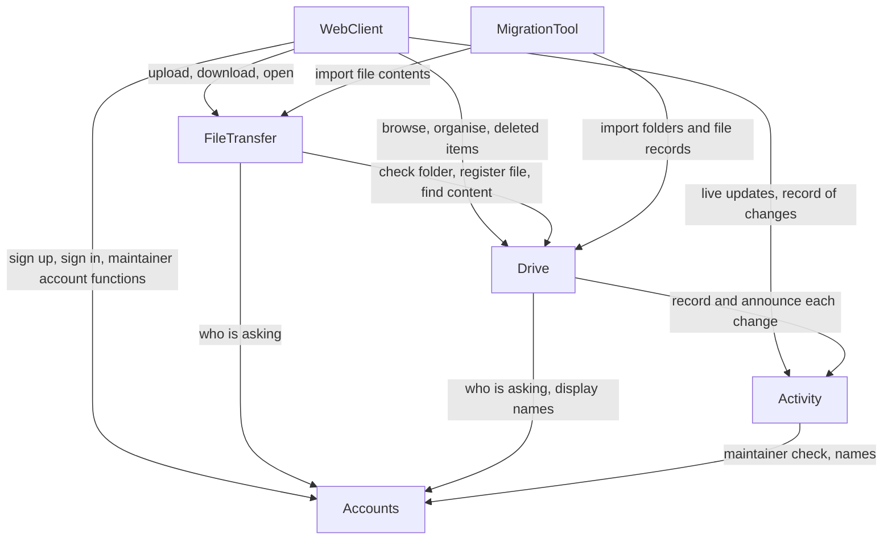

# Components: Virtuoso Drive on AWS

The building blocks of the new system: the software to be written, what each
block is responsible for, and which information each owns. Built from the
requirements
(`aidlc/spaces/default/intents/261121-aws-migration/inception/requirements-analysis/requirements.md`)
and stories
(`aidlc/spaces/default/intents/261121-aws-migration/inception/user-stories/stories.md`),
with the latest screen decisions in
`aidlc/spaces/default/intents/261121-aws-migration/inception/refined-mockups/`.
The existing system is one class in the browser talking straight to two data
stores (`aidlc/spaces/default/codekb/virtuosodrive.com/architecture.md`,
`component-inventory.md`); none of its structure is kept. The boundaries below
are also the test boundaries the team practices call for
(`aidlc/spaces/default/intents/261121-aws-migration/inception/practices-discovery/team-practices.md`).

This document does not choose AWS services, a frontend framework, or how the
blocks are deployed. Databases, storage and outside services appear only as
things a block uses. The reasons for the main choices are in `decisions.md`.

## Catalogue

```yaml
components:
  - name: WebClient
    summary: The site as it runs in the browser; shows the drive and carries out what the person chooses.
    behaviour: >
      Draws the list, breadcrumb, actions, dialogs and the maintainer screen as
      specified in the refined mockups. Holds no rule of its own that matters for
      safety: every rule it applies (name rules, size limit, who may do what) is
      applied again by the block that owns it. Shows names and display names as
      text only. Never holds cloud credentials or long-lived keys; it holds only
      the signed-in session. Keeps the person's place (folder, selection, typed
      text) across sign-in, errors and lost connections. Shows the "changed by"
      column only when signed in, and the Maintainer link only to maintainers.
    responsibilities:
      - Screens, dialogs, selection, keyboard and touch behaviour, accessibility
      - Asking for sign-in at the moment a change is chosen, then carrying on
      - Upload progress, the duplicate-name choice, and failure messages
      - Applying live updates to the open folder without disturbing the person
    depends_on:
      - component: Accounts
        interaction: Sign up, confirm, sign in and out, reset a password; maintainer account functions
        style: sync
      - component: Drive
        interaction: List a folder, create a folder, rename, delete; list and restore deleted items
        style: sync
      - component: FileTransfer
        interaction: Start and finish uploads, get a download link for a file
        style: sync
      - component: Activity
        interaction: Receive changes to the open folder; read the record of changes (maintainer)
        style: event
    dependents: []
    external_dependencies: []
    entities: []

  - name: Accounts
    summary: Who people are; whether an account is confirmed, enabled, and a maintainer.
    behaviour: >
      Creates an account from an email address, a password of at least 10
      characters and a display name; sends a confirmation link valid 24 hours;
      an unconfirmed account cannot change content. Signs people in and out.
      After 5 wrong passwords in a row for one account, pauses sign-in for that
      account for 15 minutes from the fifth; a successful sign-in or a password
      reset clears the count. Resets a forgotten password by an emailed link
      valid 24 hours and usable once. Never reveals whether an address has an
      account. Answers, for any request, which account it comes from and whether
      that account is confirmed, enabled and a maintainer; a disabled account
      stops being accepted within 15 minutes. Is the only block that holds email
      addresses; gives them out only to a maintainer. Disables, enables and
      removes accounts for a maintainer; removal erases the email address and
      display name and keeps nothing that identifies the person. The maintainer
      role is granted outside the site.
    responsibilities:
      - Accounts, their status and role
      - Confirmation and password-reset links
      - Establishing who a request comes from, for every other block
      - Display names for "changed by"; email addresses for maintainers only
    depends_on: []
    dependents:
      - component: WebClient
        interaction: Account screens and the session
      - component: Drive
        interaction: Who is asking, and display names for "changed by"
      - component: FileTransfer
        interaction: Who is asking
      - component: Activity
        interaction: Who is asking, and names for the record of changes
    external_dependencies:
      - name: Sign-in service
        kind: other
        purpose: Keeps passwords and issues sessions, so that this block never stores a password itself
      - name: Email delivery
        kind: third-party-api
        purpose: Sends confirmation and password-reset links
      - name: PostgreSQL
        kind: database
        purpose: Account status, role and display name
    entities:
      - name: Account
        identifier: accountId
        attributes: [accountId, emailAddress, displayName, emailConfirmed, status, isMaintainer, failedSignInCount, signInPausedUntil, createdAt]
      - name: OneTimeLink
        identifier: linkId
        attributes: [linkId, accountId, purpose, returnFolderId, pendingAction, expiresAt, usedAt]

  - name: Drive
    summary: The tree of folders and files, their names, and whether each is visible or deleted.
    behaviour: >
      Owns every folder and file as a record with its own generated identity; a
      name is an attribute, never an address. Lists the visible items of a
      folder, oldest first. Applies the name rules: 1 to 255 characters after
      trimming, no "/" or control characters, unique among the visible items of
      a folder ignoring case, with folders and files sharing one set of names.
      Creates folders. Renames a file, keeping its extension. Registers a file
      once its content is fully stored, resolving a name clash by the person's
      choice: replace (the earlier file becomes a deleted item), keep both (the
      lowest free number is added), or skip. Deletes by marking: the item and
      everything inside it disappear from every list, nothing stored is removed,
      and the name becomes free. A delete always finishes, including for an
      empty folder, and each chosen item is deleted entirely or not at all.
      Lists deleted items and restores one for a maintainer, to its original
      folder, numbering the name if taken, and refusing while its folder is
      itself deleted. Never removes anything for good. Refuses every change
      unless Accounts says it comes from a confirmed, enabled account. Tells
      Activity about every change, as part of the same operation. Knows whether
      an item was brought over from the old system.
    responsibilities:
      - Folders and files, their position, names, order and deleted state
      - Name rules and the outcome of name clashes
      - Who last changed each item
      - Deleted items and their restore
      - Importing folders and files during migration, keeping their order
    depends_on:
      - component: Accounts
        interaction: Check who is asking; get display names for "changed by"
        style: sync
      - component: Activity
        interaction: Record each change and announce it to people watching the folder
        style: sync
    dependents:
      - component: WebClient
        interaction: Browsing and organising
      - component: FileTransfer
        interaction: Check the target folder; register a stored file; find a file's content for download
      - component: MigrationTool
        interaction: Import folders and file records
    external_dependencies:
      - name: PostgreSQL
        kind: database
        purpose: System of record for folders and file metadata
    entities:
      - name: Folder
        identifier: folderId
        attributes: [folderId, name, parentFolderId, position, createdAt, lastChangedByAccountId, lastChangedAt, deletedAt, deletedByAccountId, broughtOver]
        references:
          - entity: Account
            owned_by: Accounts
            relationship: a folder may name the account that last changed it and the one that deleted it; neither is needed for the folder to exist
      - name: File
        identifier: fileId
        attributes: [fileId, name, folderId, position, size, contentType, contentId, createdAt, lastChangedByAccountId, lastChangedAt, deletedAt, deletedByAccountId, deletedReason, broughtOver]
        references:
          - entity: Account
            owned_by: Accounts
            relationship: a file may name the account that last changed it and the one that deleted it
          - entity: StoredContent
            owned_by: FileTransfer
            relationship: each file points to exactly one stored content

  - name: FileTransfer
    summary: Getting file contents in and out, within the size and daily limits.
    behaviour: >
      Starts an upload for a signed-in account into a named folder: refuses a
      file over 1 GB (1,000,000,000 bytes is to be confirmed against 1 GiB at
      functional design) before any byte is sent, and a file that would take the
      account past 5 GB in the current UTC day; only completed uploads count
      towards the day. Lets the browser send the content straight to storage
      using a short-lived permission for that one upload, never a cloud
      credential. Finishes an upload only when the whole content is stored and
      its size matches, then asks Drive to register the file; if Drive reports a
      name clash, returns the choice to the person. An upload that is abandoned,
      refused or skipped leaves no file record, and its content is discarded.
      Stores content under a generated key that has nothing to do with the
      file's name, so renaming never touches content and two files can never
      share a key. Gives anyone a short-lived link to download or open a visible
      file, under the name Drive holds for it; refuses for a deleted file. Never
      removes the content of a registered file.
    responsibilities:
      - Upload limits per file and per account per day
      - Short-lived permissions to send and to fetch content
      - Making sure a file is listed only when its content is completely stored
      - Stored contents, their size, type and checksum
      - Importing file contents during migration
    depends_on:
      - component: Accounts
        interaction: Check who is asking before starting an upload
        style: sync
      - component: Drive
        interaction: Check the target folder; register the file when its content is stored; look up a file's content and name for download
        style: sync
    dependents:
      - component: WebClient
        interaction: Uploading, downloading and opening files
      - component: MigrationTool
        interaction: Import file contents
    external_dependencies:
      - name: Object storage
        kind: object-store
        purpose: Holds file contents, encrypted, never public
      - name: PostgreSQL
        kind: database
        purpose: Upload sessions and stored-content records
    entities:
      - name: StoredContent
        identifier: contentId
        attributes: [contentId, storageKey, size, contentType, checksum, storedAt]
      - name: UploadSession
        identifier: uploadId
        attributes: [uploadId, accountId, targetFolderId, fileName, declaredSize, state, contentId, startedAt, finishedAt]
        references:
          - entity: Account
            owned_by: Accounts
            relationship: each upload is started by one account
          - entity: Folder
            owned_by: Drive
            relationship: each upload targets the one folder that was open when it started

  - name: Activity
    summary: The record of who changed what, and telling people who are looking at a folder that it changed.
    behaviour: >
      Records one entry for each thing a person did: uploaded, replaced, created
      a folder, renamed, deleted, restored. Deleting or restoring a folder is
      one entry stating how much was inside. An entry holds the account, the
      item, its name at the time and when; never an email address. Entries are
      kept indefinitely and cannot be changed or removed by any function of the
      site. Shows the record to a maintainer, newest first, narrowed to one
      account or one item by identity, so a renamed item is still found.
      Announces each change to everyone who has that folder open, within 5
      seconds, and only for the folder the change happened in. How the
      announcement travels is decided at design.
    responsibilities:
      - The permanent record of changes
      - Showing the record to maintainers
      - Announcing changes to the folder they happened in
    depends_on:
      - component: Accounts
        interaction: Check that a reader of the record is a maintainer; resolve accounts to names
        style: sync
    dependents:
      - component: WebClient
        interaction: Live updates; the maintainer's Changes section
      - component: Drive
        interaction: Hands over each change to record and announce
    external_dependencies:
      - name: PostgreSQL
        kind: database
        purpose: The record of changes
    entities:
      - name: ChangeRecord
        identifier: changeId
        attributes: [changeId, accountId, action, itemKind, itemId, itemName, folderId, detail, occurredAt]
        references:
          - entity: Account
            owned_by: Accounts
            relationship: each change was made by one account, which may since have been removed
          - entity: Folder
            owned_by: Drive
            relationship: each change concerns one folder or one file, in one folder
          - entity: File
            owned_by: Drive
            relationship: each change concerns one folder or one file

  - name: MigrationTool
    summary: Brings the content of the old system over, accounts for all of it, and proves the result.
    behaviour: >
      Run by the operator, never part of the running site. Reads an export of
      the old database and the old stored files; changes and deletes nothing
      there. Brings over every item that has both a record and content, keeping
      folder position, name, size, type, content and the order items are shown
      in today. Files an item under the folder where it is listed today even if
      its stored location says otherwise. Brings same-named sibling folders over
      as one folder; if that leaves two files with the same name, keeps both and
      numbers the second. Keeps names as they are, to be shown as text. Lists
      everything else in a report with a reason: content with no record, a
      record with no content, a size that does not match, a name the new rules
      cannot accept, anything outside the folder tree. Every source item
      appears in the report exactly once. Can be run as a rehearsal that records
      counts, bytes and duration. Can be run again, or resumed after an
      interruption, without duplicating anything. Includes a check that
      compares counts and total sizes with the export and fails on any
      difference the report does not account for. The only place where reading
      from Firebase is allowed.
    responsibilities:
      - Reading the old system without changing it
      - Deciding, for each source item, whether and how it is brought over
      - The migration report and the verification check
      - Rehearsal figures
    depends_on:
      - component: Drive
        interaction: Import folders and file records under the same rules as the site
        style: sync
      - component: FileTransfer
        interaction: Import file contents
        style: sync
    dependents: []
    external_dependencies:
      - name: Firebase Realtime Database export
        kind: other
        purpose: Source of folder and file records, read only
      - name: Cloud Storage for Firebase
        kind: object-store
        purpose: Source of file contents, read only
      - name: PostgreSQL
        kind: database
        purpose: Runs and report entries
    entities:
      - name: MigrationRun
        identifier: runId
        attributes: [runId, kind, startedAt, finishedAt, folderCount, fileCount, totalBytes, outcome]
      - name: MigrationEntry
        identifier: entryId
        attributes: [entryId, runId, sourceKey, sourcePath, outcome, reason, note, targetItemId]
        references:
          - entity: Folder
            owned_by: Drive
            relationship: an entry for a folder brought over names the folder it became
          - entity: File
            owned_by: Drive
            relationship: an entry for a file brought over names the file it became
```

## Component Diagram



<!-- Text fallback: WebClient calls Accounts, Drive, FileTransfer and Activity. FileTransfer calls Accounts and Drive. Drive calls Accounts and Activity. Activity calls Accounts. MigrationTool calls Drive and FileTransfer. Accounts calls nothing. Nothing calls WebClient or MigrationTool. There is no cycle. -->

## Component Summary

| Component | Purpose | Depends On | Dependents | Entities Owned |
|-----------|---------|------------|------------|----------------|
| WebClient | The site in the browser | Accounts, Drive, FileTransfer, Activity | none | none |
| Accounts | Who people are and what they may do | none | WebClient, Drive, FileTransfer, Activity | Account, OneTimeLink |
| Drive | Folders, files, names, deleted state | Accounts, Activity | WebClient, FileTransfer, MigrationTool | Folder, File |
| FileTransfer | File contents in and out, within limits | Accounts, Drive | WebClient, MigrationTool | StoredContent, UploadSession |
| Activity | Record of changes and live updates | Accounts | WebClient, Drive | ChangeRecord |
| MigrationTool | Bringing the old content over and proving it | Drive, FileTransfer | none | MigrationRun, MigrationEntry |

## Entity Ownership

| Entity | Owning Component | Identifier | Attributes | References |
|--------|------------------|------------|------------|------------|
| Account | Accounts | accountId | emailAddress, displayName, emailConfirmed, status, isMaintainer, failedSignInCount, signInPausedUntil, createdAt | none |
| OneTimeLink | Accounts | linkId | accountId, purpose, returnFolderId, pendingAction, expiresAt, usedAt | none outside Accounts |
| Folder | Drive | folderId | name, parentFolderId, position, createdAt, lastChangedByAccountId, lastChangedAt, deletedAt, deletedByAccountId, broughtOver | Account (Accounts) |
| File | Drive | fileId | name, folderId, position, size, contentType, contentId, createdAt, lastChangedByAccountId, lastChangedAt, deletedAt, deletedByAccountId, deletedReason, broughtOver | Account (Accounts), StoredContent (FileTransfer) |
| StoredContent | FileTransfer | contentId | storageKey, size, contentType, checksum, storedAt | none |
| UploadSession | FileTransfer | uploadId | accountId, targetFolderId, fileName, declaredSize, state, contentId, startedAt, finishedAt | Account (Accounts), Folder (Drive) |
| ChangeRecord | Activity | changeId | accountId, action, itemKind, itemId, itemName, folderId, detail, occurredAt | Account (Accounts), Folder and File (Drive) |
| MigrationRun | MigrationTool | runId | kind, startedAt, finishedAt, folderCount, fileCount, totalBytes, outcome | none |
| MigrationEntry | MigrationTool | entryId | runId, sourceKey, sourcePath, outcome, reason, note, targetItemId | Folder and File (Drive) |

Every entity has one owner. Where one block needs another's information it
holds only the identifier and asks the owner. Two things follow that matter
for privacy and for the record:

- **Email addresses exist only in Account.** Drive and Activity hold `accountId`. When an account is removed, those identifiers no longer resolve, and that is what "Deleted account" means on screen.
- **`OneTimeLink.returnFolderId`** holds a folder's identifier so a confirmed person lands back where they were; it is not followed as a reference and may point to a folder that has since been deleted, in which case they land at "All".

## External Dependencies

| Component | Dependency | Kind | Purpose |
|-----------|------------|------|---------|
| Accounts | Sign-in service | other | Keeps passwords and issues sessions |
| Accounts | Email delivery | third-party-api | Confirmation and password-reset links |
| Accounts | PostgreSQL | database | Account status, role, display name |
| Drive | PostgreSQL | database | Folders and file metadata |
| FileTransfer | Object storage | object-store | File contents |
| FileTransfer | PostgreSQL | database | Upload sessions and stored-content records |
| Activity | PostgreSQL | database | Record of changes |
| MigrationTool | Firebase Realtime Database export | other | Source records, read only |
| MigrationTool | Cloud Storage for Firebase | object-store | Source contents, read only |
| MigrationTool | PostgreSQL | database | Runs and report entries |

Only MigrationTool touches anything of Google's, read only, and it is not part
of the running site, so the rule against a Google dependency at runtime holds.

## Rationale

| Component | Why it is a separate building block |
|-----------|-------------------------------------|
| WebClient | The only part that runs in the browser and the only part a student sees. It changes for reasons of look and usability; nothing it does can be trusted for safety |
| Accounts | The only holder of personal data and the only judge of who may do what. Keeping it apart keeps email addresses in one place and makes "refused without a valid account" testable in one place |
| Drive | The heart of the product: the rules about names, positions and deleted state. These rules are where most of the old defects were, and they can be tested without any file content |
| FileTransfer | Deals in bytes, limits and short-lived permissions, which fail in different ways (interrupted, too large, over the daily limit) from anything in Drive. Separating it is what stops a name and a stored key drifting together again |
| Activity | Written to by Drive, read by maintainers, never edited. Its data has a different lifetime (kept indefinitely) and a different audience from everything else |
| MigrationTool | Used for a short time by one person, outside the site, and the only code allowed to read Firebase. It must not become something the running site depends on |

### Alternatives Rejected

- **Four blocks** (Drive also handling file transfer and activity): offered to the maintainer, who chose six (domain design answer Q1). It would have been quicker to start but would have put name rules, byte handling and the permanent record in one place.
- **A separate maintainer block**: rejected. Each maintainer function is a small addition to the block that owns the data (accounts in Accounts, deleted items in Drive, the record in Activity); a separate block would have had to reach into all three.
- **One "Item" entity instead of Folder and File**: left open for functional design, which fixes the schema. They are listed separately here because a file has content and a folder has children; the shared rule that names are unique across both belongs to Drive either way.

## What this leaves for later stages

- How the blocks are grouped for deployment, and in what order they are built: Units Generation.
- The exact operations and data that cross each boundary: Contract Design.
- Full attributes, types and rules of each entity: Functional Design.
- How live updates travel, which sign-in and email services are used, the Region, and how PostgreSQL is run: the NFR and infrastructure stages. The maintainer chose account screens built into the site, which constrains the choice of sign-in service (see ADR-006 in `decisions.md`).
- Delivery, logging, alarms and going back to a previous version (stories US9.1 to US9.4) are not components; they belong to the pipeline and infrastructure stages.
